# foundry-autonomous-sdlc

## Live demo

- App: <https://stevengonsalvez.github.io/foundry-autonomous-sdlc/>
- Control center (every ticket from backlog to prod with cost per ticket, gates, environment hops, agent health, escalations, flow metrics, the questions-back trail, and Azure's billed spend next to the ledger's estimate): <https://stevengonsalvez.github.io/foundry-autonomous-sdlc/control-center/>
- App evolution showcase (visual timeline across releases): <https://stevengonsalvez.github.io/foundry-autonomous-sdlc/history/>
- Staging (the build waiting for smoke and soak): <https://stevengonsalvez.github.io/foundry-autonomous-sdlc/staging/>
- Metrics dashboard (cycle time per stage, defect owner and resolution time, cost per issue, gate pass rates): <https://stevengonsalvez.github.io/foundry-autonomous-sdlc/dashboard/>
- Traces of every scenario, from issue to release: [`docs/evidence.md`](docs/evidence.md)
- Final report with the success criteria and their evidence: [`docs/final-report.md`](docs/final-report.md)

### Control center

  <a href="https://stevengonsalvez.github.io/foundry-autonomous-sdlc/control-center/">
    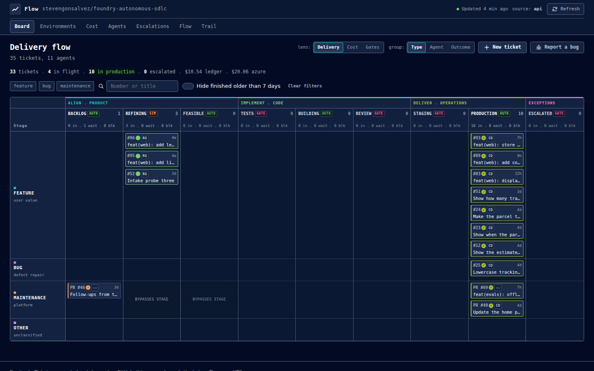
  </a>

More views: ticket, cost, environments, agents, escalations, flow

| | |
|---|---|
| 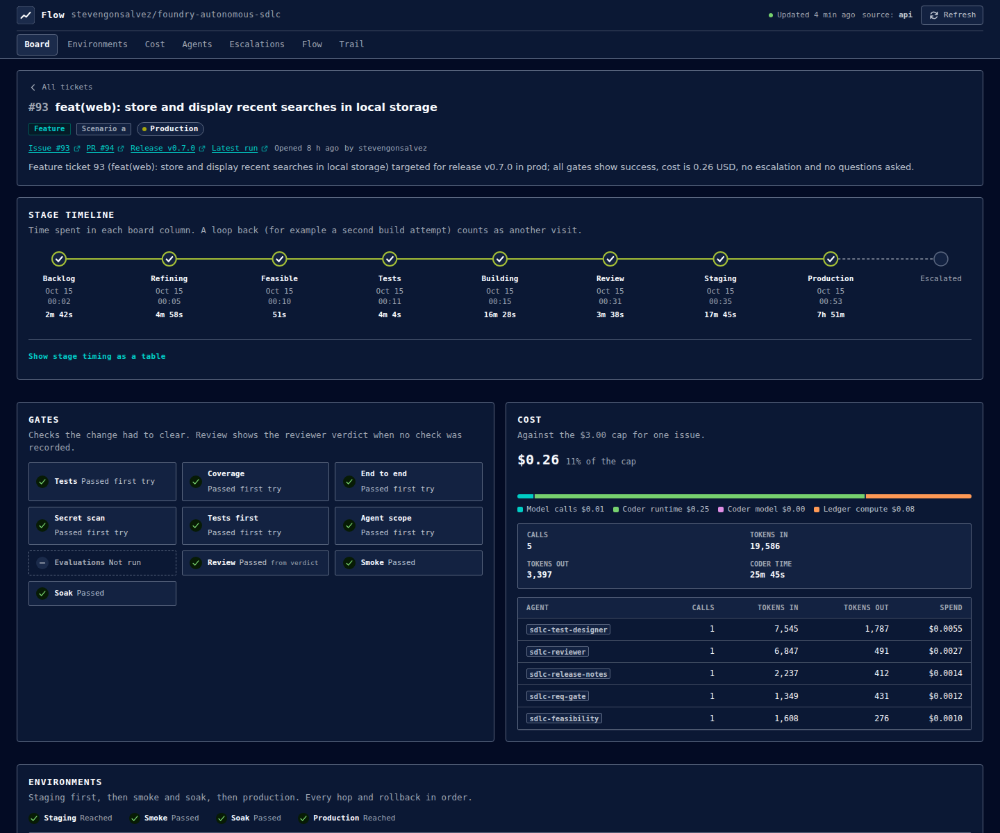 | 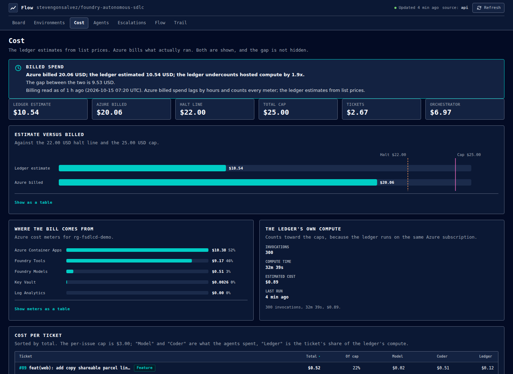 |
| 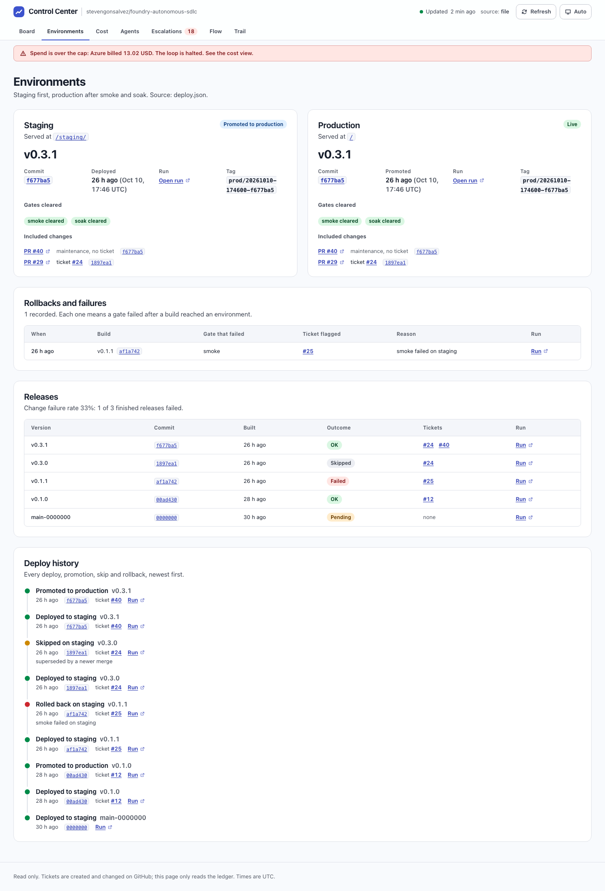 | 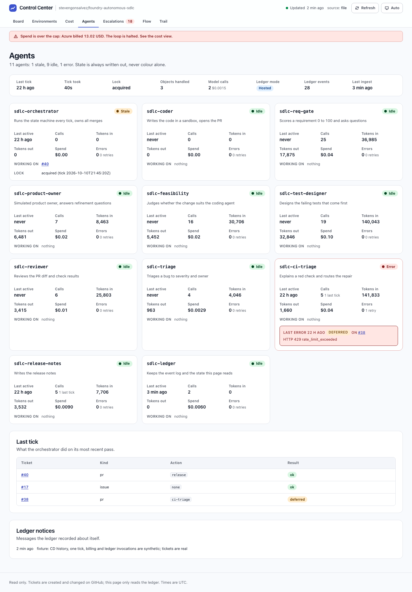 |
| 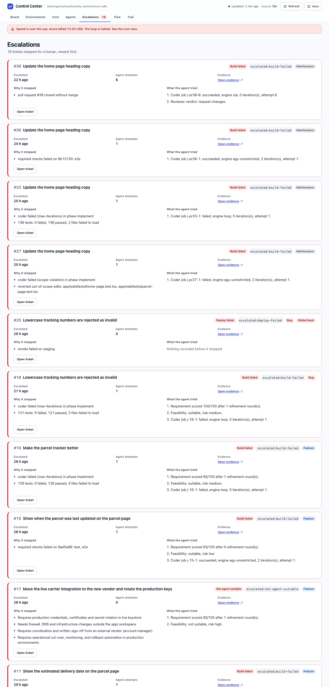 | 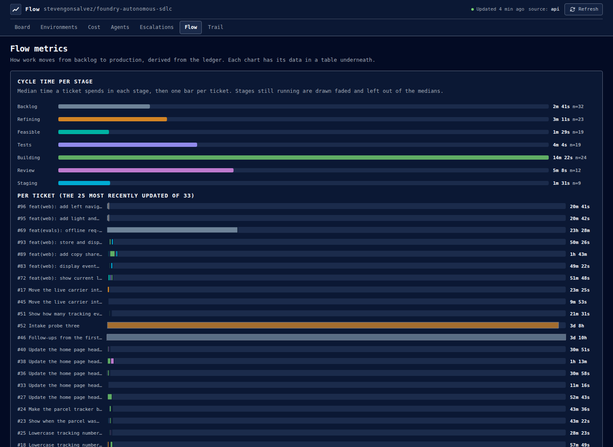 |

  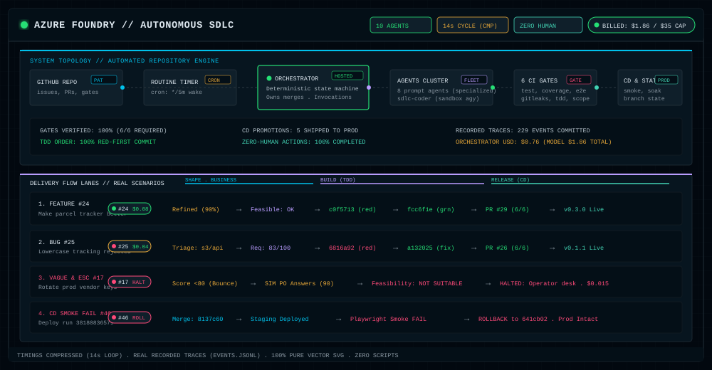

An issue is filed. Agents on Azure AI Foundry score and refine the requirement, judge whether an agent can do the work, write failing tests first, build until the tests pass, review independently, merge and release. No human step. This repository is the demonstration, and every claim below links to a command you can run or a trace you can click.

## How the app evolved

See the visual timeline across releases on the [**App Evolution Showcase**](https://stevengonsalvez.github.io/foundry-autonomous-sdlc/history/).

  
  
  

  <b>Left:</b> v0.1.0 (home page) &nbsp;|&nbsp; <b>Center:</b> v0.3.1 (heading copy) &nbsp;|&nbsp; <b>Right:</b> v0.4.0 (tracking events) | <a href="https://stevengonsalvez.github.io/foundry-autonomous-sdlc/history/">Explore interactive history &rarr;</a>

## System topology

  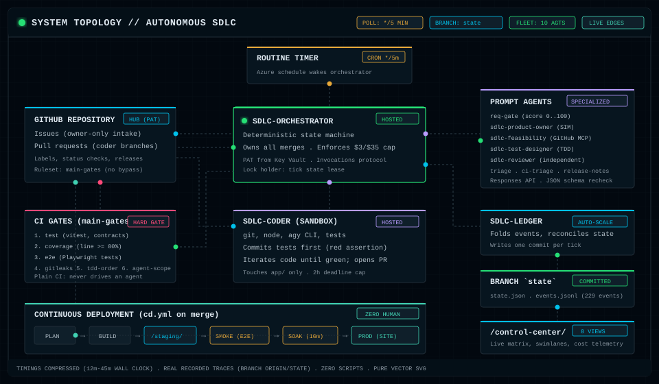

## Real execution scenarios

The animations below are built from authentic recorded traces in branch `origin/state` (`events.jsonl` and `state.json`). Timings are compressed for demonstration (actual wall-clock runtimes: 2m to 18m). Pure vector animated SVGs with GIF fallbacks in `docs/media/`.

<b>Scenario 1: Feature happy path (Issue #24, PR #29, Release v0.3.0)</b>

Requirement scored, bounced below 80, refined by simulated product owner to 90, feasibility confirmed, TDD failing test committed first (`c0f5713`), implemented until green (`fcc6f1e`), approved by independent review, all 6 CI checks green, staged, smoke and 10-minute soak verified, released to prod. Total cost: $0.0816 USD.

  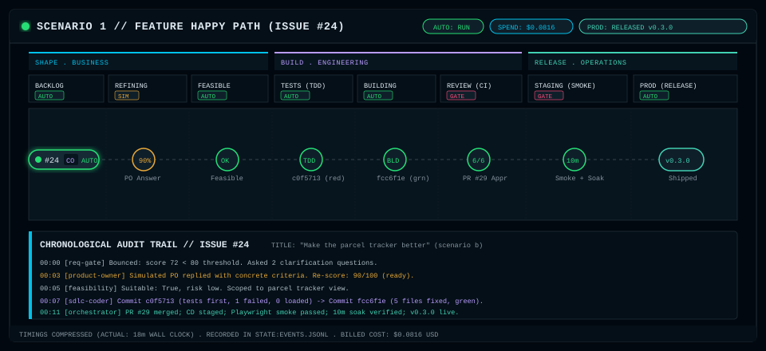

<b>Scenario 2: Bug with failing regression test first (Issue #25, PR #26, Release v0.1.1)</b>

Bug triaged automatically (severity s3, owner api), requirement scored 83, failing regression test committed first (`6816a92`), fix committed (`a132025`), reviewed and verified across 6 gates, released. Total cost: $0.0368 USD.

  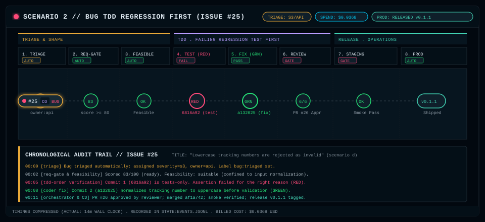

<b>Scenario 3: Vague requirement and not-agent-suitable escalation (Issue #17)</b>

Initial requirement scored below 80 and bounced, simulated product owner clarifies scope, feasibility agent evaluates against repository contracts and judges not suitable (requires live production secrets, DNS/firewall changes, vendor agreement). Cleanly halted on the coral escalation path for human operator with zero rogue code edits. Total cost: $0.0153 USD.

  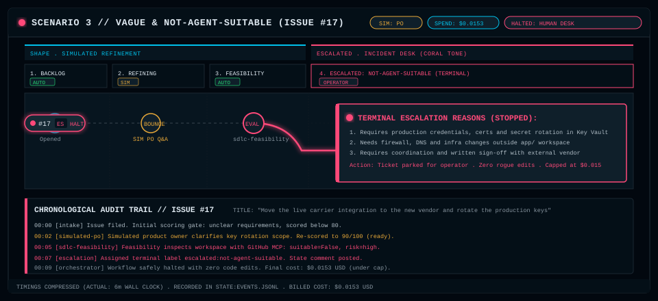

<b>Scenario 4: Continuous deployment smoke fail and rollback (PR #46 / Run 38180836579)</b>

Merged commit `8137c60` deployed to `/staging/`. Playwright smoke test fails on staging. Automated rollback immediately restores previous healthy production build (`641cb02`). Ticket flagged with label `escalated:deploy-failed`. Production root remains untouched with zero downtime.

  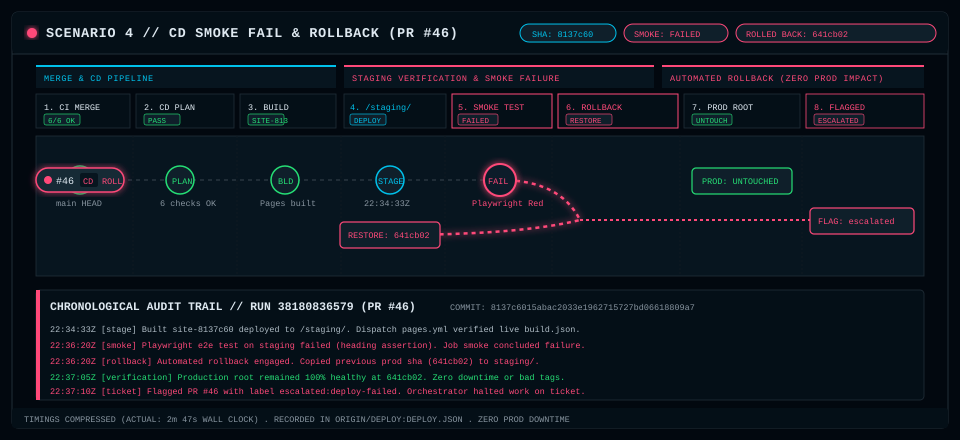

## What it shows

| Problem | What this repo does about it |
|---------|------------------------------|
| Test design and evidence are manual and slow | Agents write the tests first, then build; every PR carries its red and green output |
| Poor requirement quality derails humans and agents | A scoring gate (80 percent) sends vague issues back with questions; a labelled simulated product owner answers |
| Triage is pass-the-parcel | A triage agent assigns severity and an owner; resolution time is charted |
| Bugs rarely become tests | Every bug gets a failing regression test before the fix |
| Mock APIs and contract tests come late | The app has an OpenAPI carrier contract, a mock server and contract tests |
| Test automation rots | A maintenance flow repairs a deliberately stale test |
| No golden path for Foundry agents | Terraform modules, a bootstrap, a deploy script and a runbook |

## Documentation

| Doc | What |
|-----|------|
| [`docs/architecture.md`](docs/architecture.md) | Contracts: agents, state machine, labels, ledger events and state |
| [`docs/decisions.md`](docs/decisions.md) | Design decisions and the alternatives rejected |
| [`docs/findings.md`](docs/findings.md) | Measured facts and problems found while running it |
| [`docs/evidence.md`](docs/evidence.md) | Issue to release traces for every scenario |
| [`docs/final-report.md`](docs/final-report.md) | Success criteria and their evidence |
| [`docs/control-center-report.md`](docs/control-center-report.md) | Control center, continuous deployment and ledger build report |
| [`docs/cd.md`](docs/cd.md) | Staging, smoke, soak, promote and rollback |
| [`docs/runbook.md`](docs/runbook.md) | Bootstrap, deploy, operate, tear down |
| [`docs/research/sandboxing-security-options.md`](docs/research/sandboxing-security-options.md) | Security review, threat model and sandboxing options for the coder, with a phased plan |
| [`docs/research/foundry-evaluations.md`](docs/research/foundry-evaluations.md), [`docs/research/foundry-evaluations-demo.md`](docs/research/foundry-evaluations-demo.md) | Agent evaluations research, options matrix, proof run against demo project, and options demo walkthrough |
| [`docs/app-spec.md`](docs/app-spec.md) | Spec of the parcel tracker demo app |
| [`docs/poc-spec.md`](docs/poc-spec.md), [`docs/poc-findings.md`](docs/poc-findings.md) | The earlier Actions-driven proof of concept: spec and findings |
| [`docs/explainer/`](docs/explainer/README.md) | Visual explainer of the whole system |
| [`docs/proof/`](docs/proof/) | Screenshots of the app, dashboard and control center, including the live runs |
| [`apps/control-center/README.md`](apps/control-center/README.md), [`PRODUCT.md`](apps/control-center/PRODUCT.md), [`DESIGN.md`](apps/control-center/DESIGN.md), [`RESEARCH-flowtron.md`](apps/control-center/RESEARCH-flowtron.md) | Control center usage, product brief, design system, UI research |
| [`dashboard/README.md`](dashboard/README.md) | Metrics dashboard |
| [`agents/README.md`](agents/README.md), [`app/README.md`](app/README.md) | Agents package and demo app |
| [`infra/terraform/README.md`](infra/terraform/README.md), [`bootstrap`](infra/terraform/bootstrap/README.md) | Terraform stack and remote-state bootstrap |
| [`reference/actions-sandbox/README.md`](reference/actions-sandbox/README.md) | The earlier Actions sandbox, kept for comparison |

Live repository views: [issues](https://github.com/stevengonsalvez/foundry-autonomous-sdlc/issues), [pull requests](https://github.com/stevengonsalvez/foundry-autonomous-sdlc/pulls), [releases](https://github.com/stevengonsalvez/foundry-autonomous-sdlc/releases), [Actions runs](https://github.com/stevengonsalvez/foundry-autonomous-sdlc/actions), [the `state` branch](https://github.com/stevengonsalvez/foundry-autonomous-sdlc/tree/state) (`state.json` and `events.jsonl` written by the ledger).

## The gates

Every agent PR must pass six required checks on the exact head commit before the orchestrator may merge it, and GitHub enforces the same six server side (branch ruleset `main-gates`, no bypass actors):

| Check | Passes when |
|-------|-------------|
| `test` | lint, typecheck, unit, component and contract tests pass |
| `coverage` | line coverage is at least 80 percent |
| `e2e` | Playwright tests pass |
| `gitleaks` | no secrets in the PR range |
| `tdd-order` | the first commit is tests only, the tests fail for the right reason (an assertion, not a load error), and later commits do not edit them |
| `agent-scope` | an agent branch only touches `app/` |

On top of that the orchestrator requires a review marker from the independent review agent for the same head commit, owner authorship, a cost under the cap, and that every changed file is under `app/`.

## Safety model in one table

| Risk | Control |
|------|---------|
| A stranger files an issue to spend money | Only issues and PRs by the repo owner are acted on |
| Prompt injection through issue text | All issue, PR and file text is delimited untrusted data; outputs are schema checked and sanitised; labels, paths and commands are allow-listed |
| The coding CLI is tricked into stealing secrets | It runs as an unprivileged user with an environment built from nothing; the GitHub token exists only in short-lived git subprocesses owned by the coder process; checkouts are scanned for links, nested repos and out-of-scope paths before every push |
| The coding CLI or the code it runs sends data to, or pulls from, an arbitrary host | Optional and off by default (preview): an egress policy on the coder's hosted agent version, a default-deny allow-list of exact hosts, switched by `coder_egress_mode`. Enforced was measured to refuse unlisted HTTPS hosts and all plain HTTP, but no real coder job has run behind it, so it stays off until that gate is passed ([`docs/runbook.md`](docs/runbook.md) section 9). Audit blocks nothing and its decisions are not yet observable. It limits destinations, not misuse of allowed hosts: a `git push` or `npm publish` to an allowed host still works |
| Runaway spend | 3 USD per issue, 22 USD halt and 25 USD total (fail closed), 2 hour coder deadline, minimum idle timeouts. The ledger's estimate undercounts hosted compute, so the control center shows Azure's billed figure beside it (see the cost view and `docs/runbook.md`, "Spend finding") |
| A bad release reaches users | Staging first, Playwright smoke on the live staging URL, a 10 minute soak, then the same artifact is promoted; any failure restores the artifact prod already serves and flags the ticket |
| Secrets in the repo | None. Credentials live in Key Vault; gitleaks runs in CI and over full history before every push, and GitGuardian ([`gitguardian.yml`](.github/workflows/gitguardian.yml)) scans the full history on every push to `main` and weekly. Its key is only readable by workflows that run from `main`, never by a pull request |

Design decisions are in [`docs/decisions.md`](docs/decisions.md), measured facts and the problems found while running it are in [`docs/findings.md`](docs/findings.md), the contracts are in [`docs/architecture.md`](docs/architecture.md).

## Layout

| Path | What |
|------|------|
| [`app/`](app/) | The parcel tracker: `core`, `carrier-mock` (OpenAPI), `api`, `web` (React, Vite), `e2e` (Playwright) |
| [`agents/`](agents/) | Orchestrator logic, prompt agent definitions, the coder runtime and the hosted agent entry points |
| [`infra/terraform/`](infra/terraform/) | Foundry, Key Vault, observability and budget modules, plus a remote-state bootstrap |
| [`scripts/`](scripts/) | Deploy script, repo setup, merge gate scripts, scenario runner, evidence collector, Pages assembly |
| [`dashboard/`](dashboard/) | The static metrics dashboard |
| [`apps/control-center/`](apps/control-center/) | The read-only control center (8 views, no build, no token) |
| [`agents/sdlc_agents/ledger/`](agents/sdlc_agents/ledger/) | The state-keeper: events, ticket model, fold, reconcile, branch writer; hosted as `sdlc-ledger` or run inline |
| [`scripts/cd/`](scripts/cd/), [`.github/workflows/cd.yml`](.github/workflows/cd.yml) | Continuous deployment: staging, smoke, soak, promote or rollback (see [`docs/cd.md`](docs/cd.md)) |
| [`scenarios/`](scenarios/) | The four scripted scenarios |
| [`reference/`](reference/) | The earlier Actions-driven version, kept for comparison |

## Run it yourself

Everything is in [`docs/runbook.md`](docs/runbook.md): sign in, `terraform apply` from clean, load two secrets into Key Vault, deploy the agents, enable the routine, file the scenario issues with `scripts/run_scenarios.py`. A fresh clone was bootstrapped, applied and destroyed this way: see "Fresh clone reproduction" in the findings.

## Principles

- No secrets in the repository. Tests are committed before the code that makes them pass. CI never drives agents. All content is synthetic.

## License

MIT
